# HostelHub

College hostel management system. Wardens register students, allot rooms, track maintenance and complaints, log visitors and keep fee status.

DevOps capstone: FastAPI + React + PostgreSQL, Docker, GitHub Actions, Trivy, Helm on Kubernetes, Terraform (AWS EKS), Prometheus + Grafana.

## Features

- Student registration with roll number, course, year, contacts
- Rooms with capacity, live availability, allocate / vacate (full rooms are rejected)
- Maintenance requests per room: OPEN -> IN_PROGRESS -> RESOLVED
- Complaints board: OPEN / IN_REVIEW / CLOSED
- Visitor log with check-in and check-out
- Fees per student and term: PENDING / PAID, overdue flag
- Dashboard: occupancy %, free beds, pending dues, open issues

## Architecture

```
                  +-------------------- Kubernetes (namespace: hostelhub) --------------------+
 browser          |                                                                           |
   |              |   Ingress hostelhub.local                                                 |
   +--------------+--->  /      -> frontend Service -> nginx (React build)  x2               |
                  |      /api   -> backend Service  -> FastAPI (uvicorn)    x2  -- HPA        |
                  |                                     |  /metrics                           |
                  |                                     v                                     |
                  |                         postgres StatefulSet + PVC                        |
                  |                                                                           |
                  |   Prometheus --(ServiceMonitor)--> backend /metrics ---> Grafana          |
                  +---------------------------------------------------------------------------+

 git push -> GitHub Actions: test -> frontend build -> docker build -> Trivy -> GHCR -> kind deploy
 Terraform: VPC (2 public + 2 private subnets) + EKS managed node group
```

Locally, docker compose runs the same three containers. nginx in the frontend proxies `/api` to the backend.

## Tech stack

| Layer | Tools |
|---|---|
| Backend | Python 3.13, FastAPI, SQLAlchemy 2, Alembic, psycopg 3 |
| Frontend | React 19, Vite, nginx (unprivileged) |
| Database | PostgreSQL 16 |
| Tests | pytest, httpx TestClient, in-memory SQLite, ruff |
| Containers | Docker (non-root images), docker compose |
| CI/CD | GitHub Actions, GHCR, Trivy, kind |
| Kubernetes | Helm 3/4 chart, Ingress, HPA, StatefulSet |
| Cloud | Terraform, AWS VPC, EKS |
| Monitoring | prometheus-fastapi-instrumentator, kube-prometheus-stack, Grafana |

## API

Base path `/api`. Interactive docs at `/docs`.

| Method | Path | What it does |
|---|---|---|
| GET | `/health` | Liveness, no DB |
| GET | `/ready` | Readiness, runs `SELECT 1` on the DB |
| GET | `/metrics` | Prometheus metrics |
| GET, POST | `/api/students` | List (`?search=`, `?unallocated=true`) / register |
| GET, PUT, DELETE | `/api/students/{id}` | Read / update / remove |
| GET | `/api/students/{id}/fees` | Fees of one student |
| GET, POST | `/api/rooms` | List / create rooms |
| GET | `/api/rooms/available` | Rooms with at least one free bed |
| GET, PUT, DELETE | `/api/rooms/{id}` | Read (with occupants) / update / delete (only if empty) |
| POST | `/api/rooms/{id}/allocate` | Body `{"student_id": 1}`. 409 if room full or student already housed |
| POST | `/api/rooms/{id}/deallocate` | Body `{"student_id": 1}` |
| GET, POST | `/api/maintenance` | List (`?status=`, `?room_id=`) / raise request |
| GET, PUT, DELETE | `/api/maintenance/{id}` | Read / update / delete |
| PATCH | `/api/maintenance/{id}/status` | Body `{"status": "RESOLVED"}` |
| GET, POST | `/api/complaints` | List (`?status=`) / file complaint |
| GET, PUT, DELETE | `/api/complaints/{id}` | Read / update status / delete |
| GET, POST | `/api/visitors` | List (`?inside=true`) / check in |
| POST | `/api/visitors/{id}/checkout` | Check out |
| GET, POST | `/api/fees` | List (`?status=PENDING`) / raise fee |
| PUT | `/api/fees/{id}` | Update fee |
| PUT | `/api/fees/{id}/pay` | Mark paid, optional `{"payment_ref": "UPI-123"}` |
| GET | `/api/stats/summary` | Dashboard numbers |

## Run locally (Docker Compose)

```bash
docker compose up -d --build
docker compose ps
```

- UI: http://localhost:3000
- API docs: http://localhost:8000/docs
- Postgres: localhost:5432 (hostelhub / hostelhub)

The backend runs `alembic upgrade head` before starting. Data stays in the `hostelhub-pgdata` volume.

```bash
docker compose down        # keep data
docker compose down -v     # wipe data
```

## Tests

```bash
cd backend
python -m venv .venv && source .venv/bin/activate   # Windows: .venv\Scripts\activate
pip install -r requirements-dev.txt
ruff check .
pytest -v
```

Tests use in-memory SQLite through a `get_db` override. They never touch Postgres.

## Kubernetes (Helm)

```bash
kubectl apply -f k8s/namespace.yaml
helm lint helm/hostelhub
helm upgrade --install hostelhub helm/hostelhub -n hostelhub \
  --set backend.image.repository=ghcr.io/<owner>/hostelhub-backend \
  --set backend.image.tag=<git-sha> \
  --set frontend.image.repository=ghcr.io/<owner>/hostelhub-frontend \
  --set frontend.image.tag=<git-sha> \
  --set postgres.password=<db-password>
kubectl get pods,svc,ingress -n hostelhub
```

- `values-dev.yaml`: local images (`hostelhub-backend:local`), HPA off
- `values-prod.yaml`: HPA on, ServiceMonitor on, bigger volume
- Add `<ingress-ip> hostelhub.local` to your hosts file to use the Ingress

## Terraform (AWS)

```bash
cd terraform
cp terraform.tfvars.example terraform.tfvars
terraform init
terraform plan
terraform apply
aws eks update-kubeconfig --region ap-south-1 --name hostelhub-eks
terraform destroy          # when done
```

Credentials come from `aws configure` or `AWS_PROFILE`. Nothing secret is committed. See `terraform/README.md`.

## Monitoring

```bash
helm repo add prometheus-community https://prometheus-community.github.io/helm-charts
helm upgrade --install monitoring prometheus-community/kube-prometheus-stack \
  -n monitoring --create-namespace -f monitoring/prometheus-values.yaml \
  --set grafana.adminPassword=<password>
helm upgrade hostelhub helm/hostelhub -n hostelhub --reuse-values --set serviceMonitor.enabled=true
kubectl create configmap hostelhub-dashboard -n monitoring \
  --from-file=monitoring/grafana-dashboard-hostelhub.json
kubectl label configmap hostelhub-dashboard -n monitoring grafana_dashboard=1
kubectl port-forward -n monitoring svc/monitoring-grafana 3001:80
```

Dashboard panels: request rate, p50/p95/p99 latency, 5xx ratio, status classes, writes by method.

## CI/CD

`.github/workflows/ci-cd.yml` runs on push to `main`, pull requests and manual dispatch.

| Job | What it does |
|---|---|
| `test` | ruff lint + `pytest -v`. Fails the pipeline on any failure |
| `frontend-build` | `npm ci && npm run build` |
| `build-scan-push` | Builds both images tagged with the commit SHA, Trivy scan (HIGH/CRITICAL, fail on fixable), pushes to GHCR on `main` |
| `deploy-kind` | On `main`: creates a kind cluster, loads the scanned images, `helm upgrade --install`, waits for rollout, smoke-tests `/health`, `/ready` and the UI |

Images: `ghcr.io/<owner>/hostelhub-backend:<sha>` and `ghcr.io/<owner>/hostelhub-frontend:<sha>`. Only `GITHUB_TOKEN` is used.

## Security

- Both images run as non-root (uid 10001 backend, uid 101 nginx)
- Trivy gate on HIGH/CRITICAL. pip is removed from the backend runtime image, which drops its vendored libraries that Trivy flagged
- DB password lives in a Kubernetes Secret, passed with `--set` at deploy time

## Project layout

```
backend/     FastAPI app, Alembic migrations, pytest suite, Dockerfile
frontend/    React + Vite app, nginx config template, Dockerfile
helm/        hostelhub Helm chart
k8s/         namespace
terraform/   AWS VPC + EKS
monitoring/  kube-prometheus-stack values, Grafana dashboard
.github/     CI/CD workflow
```

## Screenshots

All taken from real runs on my machine (Windows, Docker Desktop).

### Dashboard
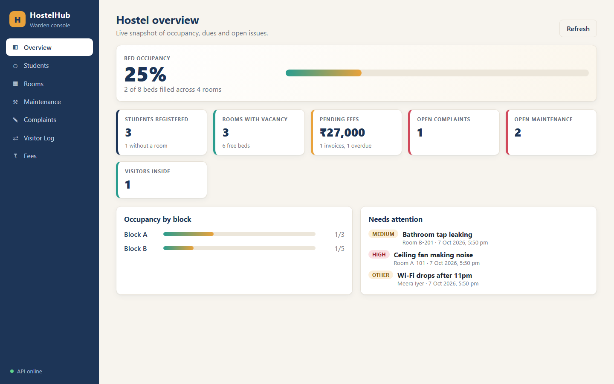

Mobile width:

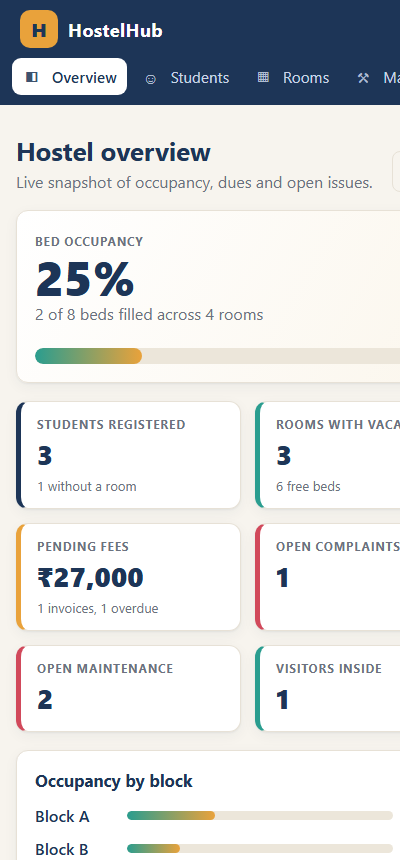

### Rooms and allocation
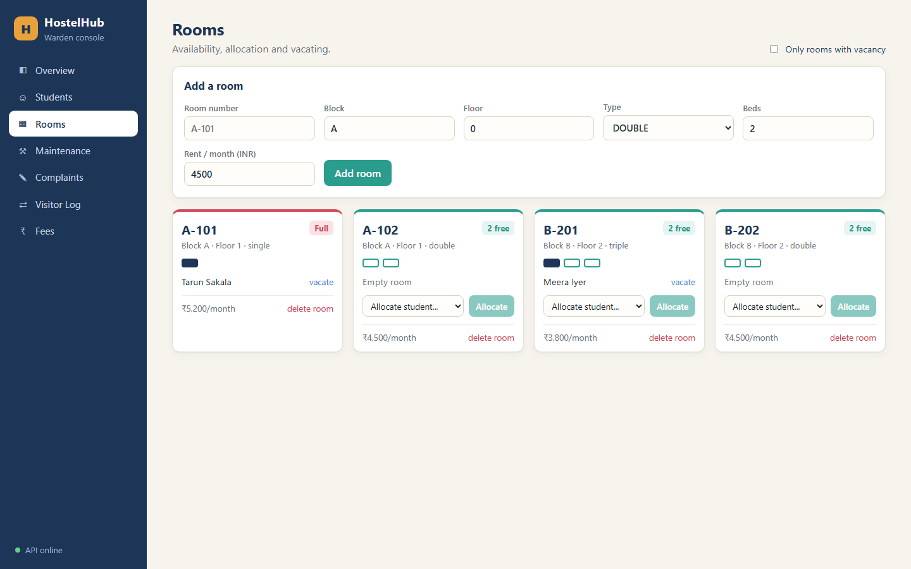

### Students
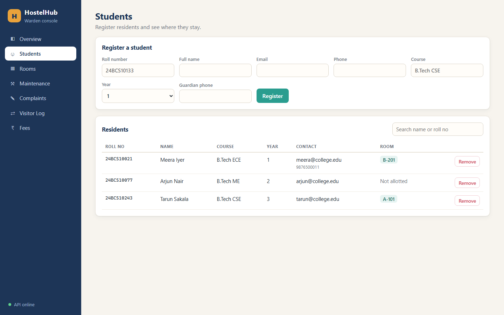

### Maintenance
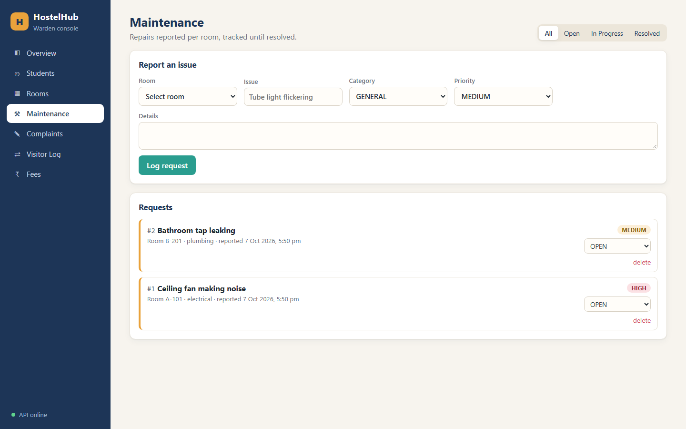

### Complaints
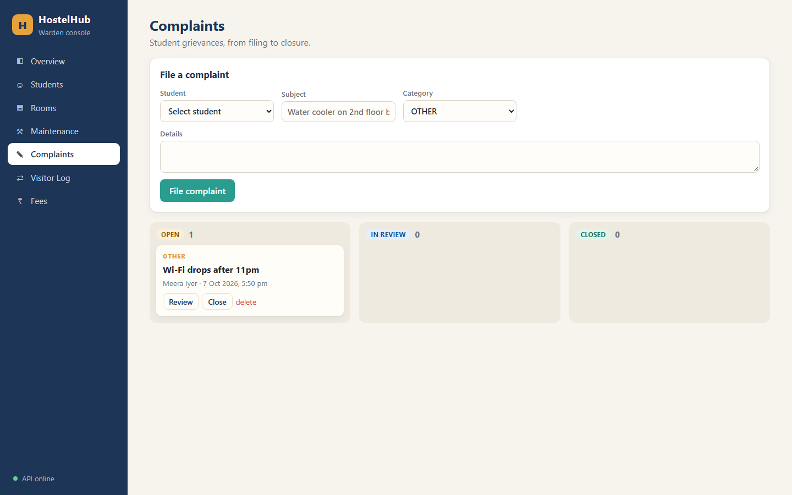

### Visitor log
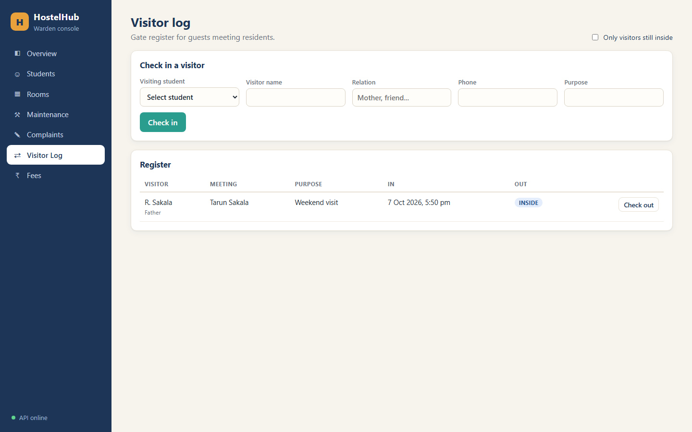

### Fees
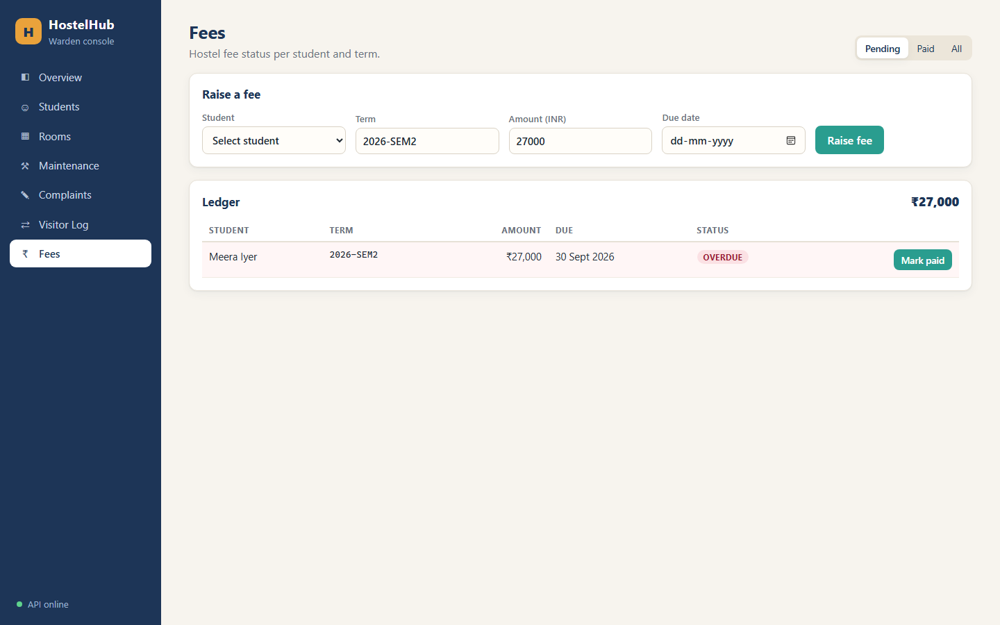

### pytest output
22 tests on in-memory SQLite (never the real DB).

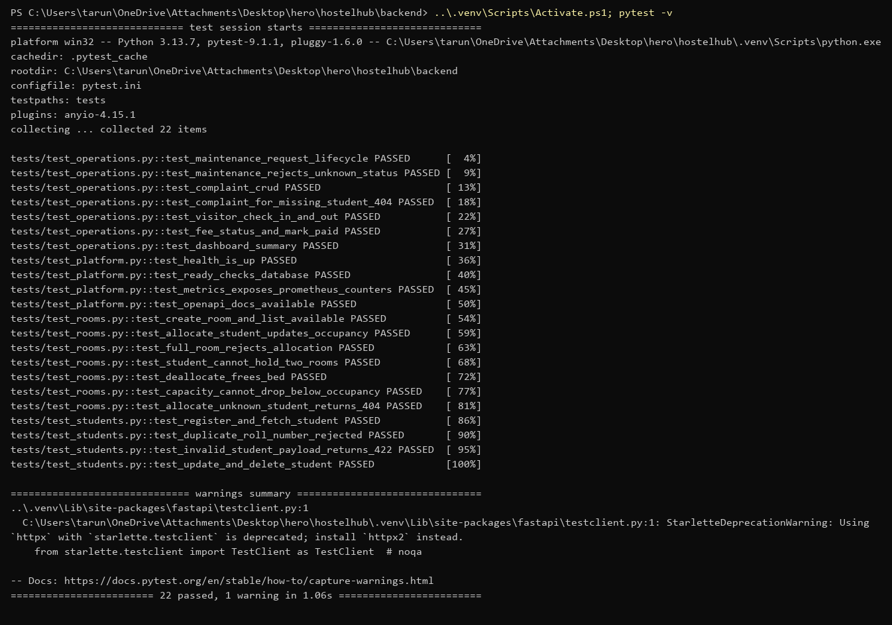

### docker compose
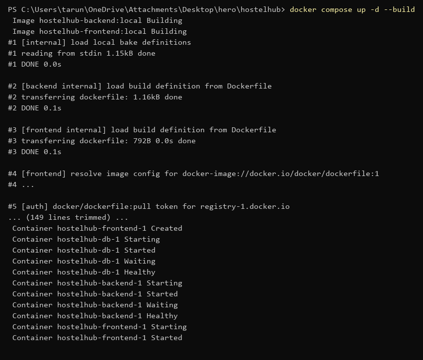
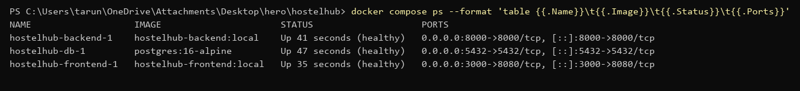

### Backend endpoints
`/health`, `/ready` (checks the DB), `/docs`:

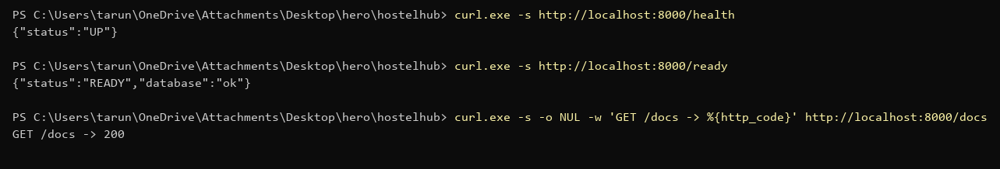

`/metrics` (Prometheus format):

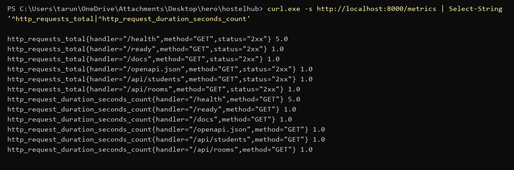

Swagger UI:

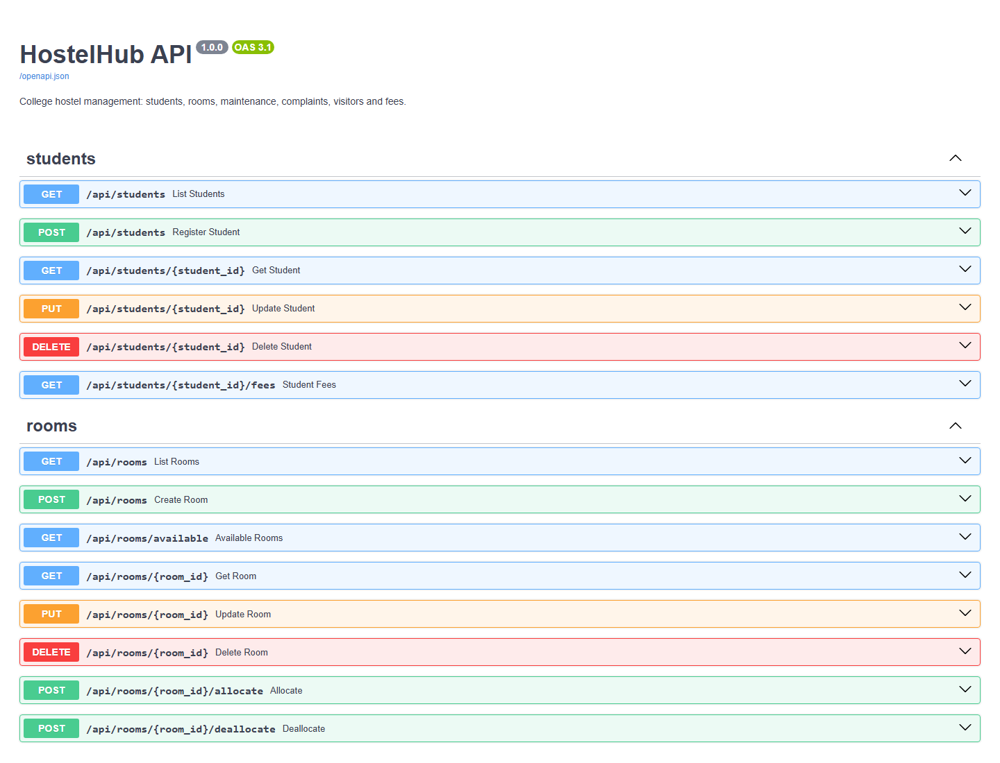

### API calls
POST → PUT → allocate room → DELETE → GET gives 404:

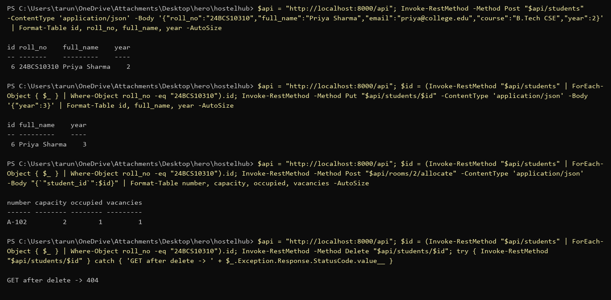

Room capacity is enforced:

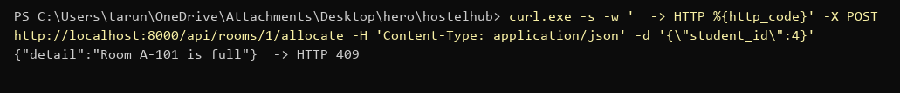

### Trivy scan
Both images: 0 HIGH/CRITICAL fixable CVEs, exit code 0 (the CI gate uses the same flags).

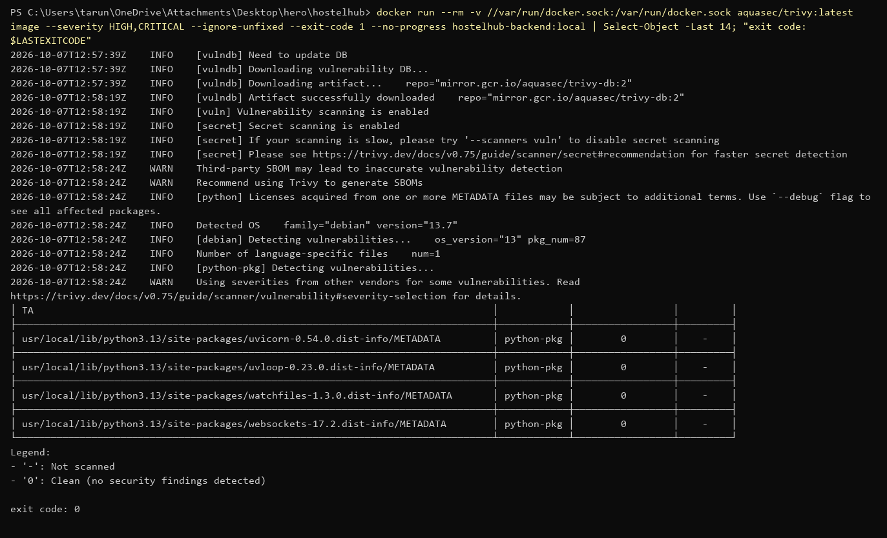
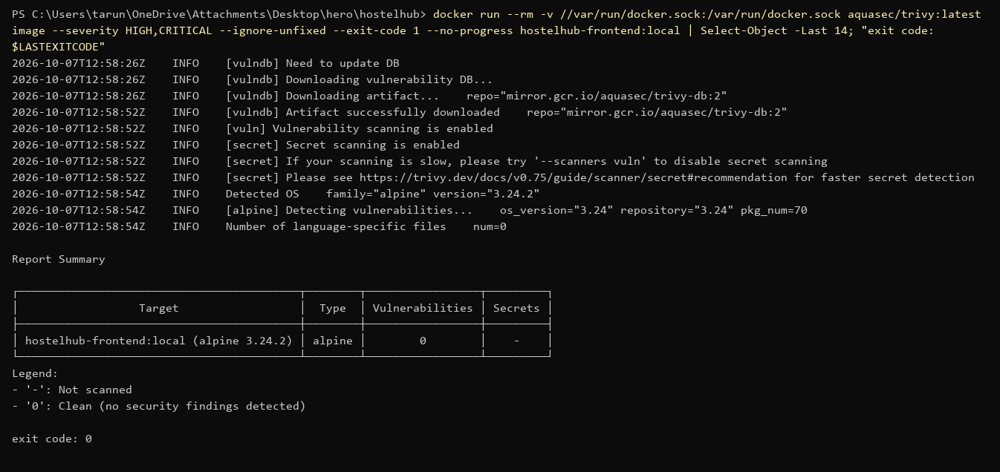

Both containers run as non-root:

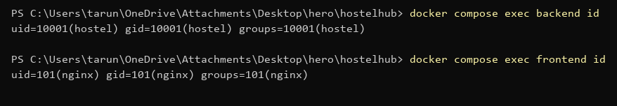

### Helm lint
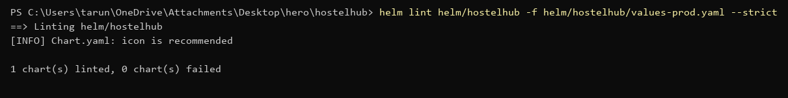

### Terraform
`fmt` + `init` + `validate` pass. No AWS credentials, so `plan`/`apply` were not run.

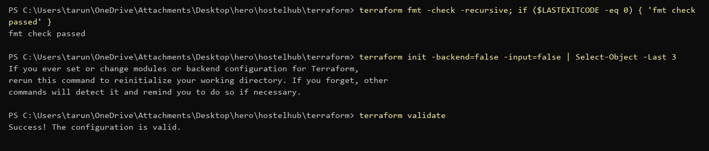

### Still to capture
- GitHub Actions pipeline run + GHCR packages (after the first push)
- `kubectl get pods/svc`, `helm list`, Ingress in browser
- Prometheus targets + Grafana dashboard (kube-prometheus-stack)
